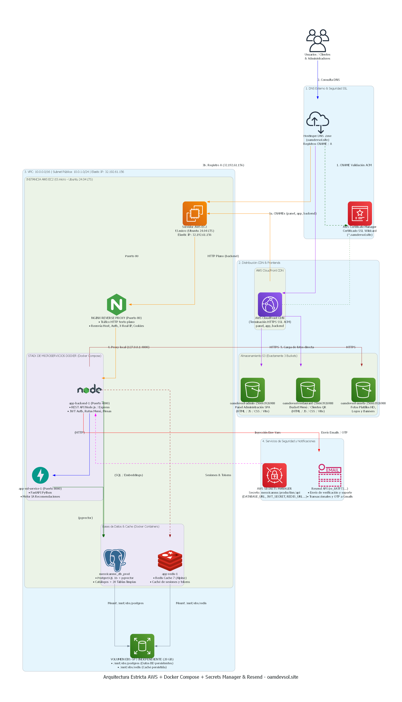

# MexxicanMX — Plataforma SaaS de Menús Digitales con QR

[](https://nodejs.org/)
[](https://react.dev/)
[](https://www.typescriptlang.org/)
[](https://fastapi.tiangolo.com/)
[](https://www.postgresql.org/)
[](https://redis.io/)
[](https://aws.amazon.com/)
[](https://www.docker.com/)

---

## 📌 Descripción General

**MexxicanMX** es una plataforma SaaS integral para la digitalización de experiencias gastronómicas. Proporciona a los comensales menús digitales interactivos mediante códigos QR dinámicos, recomendaciones basadas en IA con vectorización semántica (`pgvector`), y ofrece a restaurantes y administradores paneles completos para el control de inventario, personalización de cartas, pedidos, suscripciones y analíticas.

---

## 🌐 Entornos y Subdominios en Producción

Toda la infraestructura opera bajo el dominio institucional **`oamdevsol.site`** con cifrado SSL/TLS de extremo a extremo gestionado con **AWS Certificate Manager (ACM)**:

| Subdominio / URL | Origen en AWS | Capa CDN / Seguridad | Función Principal |
| :--- | :--- | :--- | :--- |
| https://app.oamdevsol.site | Bucket S3: `oamdevsol-restaurant-256663926988` | CloudFront (HTTPS) | Menú comensales y dashboard de restaurantes (SPA React/Vite) |
| https://panel.oamdevsol.site | Bucket S3: `oamdevsol-admin-256663926988` | CloudFront (HTTPS) | Panel de control Super Admin (SPA React/Vite/Tailwind) |
| https://cdn.oamdevsol.site | Bucket S3: `oamdevsol-assets-256663926988` | CloudFront (HTTPS) | CDN multimedia de fotografías en HD, banners y logotipos |
| https://backend.oamdevsol.site | EC2 (`32.192.61.156`) Nginx :80 ➔ Node :4000 | CloudFront (HTTPS Edge) | API REST, Auth JWT, Webhooks y endpoints de datos |

---

## 🏗️ Arquitectura Oficial de Despliegue en AWS

A continuación se muestra el diagrama arquitectónico estricto de la infraestructura en producción:



### Flujo y Componentes de Infraestructura:

1. **DNS Externo & Certificados SSL:**
   - **Hostinger DNS Zone (`oamdevsol.site`):** Gestiona los registros `CNAME` hacia CloudFront y registro `A` hacia la Elastic IP de la instancia EC2.
   - **AWS Certificate Manager (ACM):** Certificado SSL Wildcard (`*.oamdevsol.site`) en `us-east-1` validado vía CNAME.
2. **Capa CDN & Frontends (Amazon CloudFront + S3):**
   - CloudFront realiza la terminación SSL/TLS en el borde y sirve los assets estáticos desde **3 Buckets S3 dedicados** con latencia ultra-baja.
3. **VPC y Cómputo Backend (Amazon EC2 + Docker Compose):**
   - **Instancia EC2 (t3.micro, Ubuntu 24.04 LTS):** Elastic IP dedicada `32.192.61.156` en VPC `10.0.0.0/16`.
   - **Nginx Reverse Proxy:** Recibe tráfico HTTP en el puerto 80 desde CloudFront preservando cabeceras reales (`Host`, `X-Real-IP`, cookies, etc.).
   - **Microservicios Docker:**
     - `app-backend-1`: Node.js 20 + Express REST API (puerto 4000).
     - `app-ml-service-1`: FastAPI Python (puerto 8000) para motor de recomendación e IA.
     - `mexxicanmx_db_prod`: PostgreSQL 16 con extensión `pgvector` y 20 tablas de contrato relacional verificadas.
     - `app-redis-1`: Redis Cache 7 (Alpine) para sesiones rápidas y tokens de revocación.
4. **Almacenamiento Persistente (Amazon EBS gp3):**
   - Volumen independiente de **20 GB** montado en `/mnt/ebs/postgres` (persistencia de datos indeleble) y `/mnt/ebs/redis`.
5. **Seguridad y Notificaciones:**
   - **AWS Secrets Manager:** Almacén seguro `mexxicanmx/production/api` para variables de entorno de producción sin secretos en el código.
   - **Resend API:** Servicio de correos transaccionales, OTP y notificaciones de soporte.

---

## 📂 Estructura del Repositorio

```text
menus-qr-Negocios/
├── admin/                 # SPA React/TypeScript del Super Admin
├── frontend/              # SPA React/TypeScript para Comensales y Restaurantes
├── backend/               # API REST en Node.js/Express
├── ai-engine/             # Motor complementario de IA
├── ml-service/            # Microservicio FastAPI para recomendaciones
├── db/                    # Contratos de PostgreSQL y esquemas DDL
├── docs/                  # Documentación técnica, ADRs y diagramas
│   ├── adr/               # Architecture Decision Records (ADR-001)
│   ├── img/               # Diagramas de arquitectura (PNG)
│   ├── *.drawio           # Diagramas editables (Draw.io)
│   └── aws_architecture.py# Script de generación Diagrams as Code
├── scripts/               # Scripts de mantenimiento y despliegue
├── compose.yml            # Orquestación Docker para desarrollo local
├── compose.prod.yml       # Orquestación Docker para producción
└── README.md              # Documentación principal
```

---

## 🚀 Inicio Rápido (Desarrollo Local)

### Requisitos

- [Node.js 20+](https://nodejs.org/)
- [Docker](https://www.docker.com/) y [Docker Compose](https://docs.docker.com/compose/)

### Ejecución

```bash
# Clonar repositorio
git clone https://github.com/osbaldoXxC/menus-qr-Negocios.git
cd menus-qr-Negocios

# Variables de entorno base
cp .env.example .env

# Levantar servicios
docker compose up -d
```

Accesos locales:

- Frontend: http://localhost:3000
- Admin: http://localhost:5173
- Backend API: http://localhost:4000
- ML Service: http://localhost:8000
- PostgreSQL: localhost:5432

---

## 🌿 Flujo de Trabajo (Git Flow)

Este repositorio se trabaja bajo **Git Flow**. Toda contribución, sin importar el tamaño, sigue este flujo — no se hace push directo a `main` ni a `develop`.

### Ramas principales

| Rama | Propósito | Reglas |
| :--- | :--- | :--- |
| `main` | Código en **producción**. Cada commit en `main` es un release desplegado. | Protegida. Solo recibe merge desde `release/*` o `hotfix/*` vía PR aprobado. |
| `develop` | Integración de todo el desarrollo activo. Base de la próxima release. | Protegida. Solo recibe merge desde `feature/*`, `release/*` o `hotfix/*` vía PR. |

### Ramas de soporte

| Prefijo | Se crea desde | Se fusiona en | Uso |
| :--- | :--- | :--- | :--- |
| `feature/<nombre-corto>` | `develop` | `develop` | Una funcionalidad, endpoint o módulo nuevo (ej. `feature/idor-ownership-checks`, `feature/menu-recomendaciones-ia`). |
| `fix/<nombre-corto>` | `develop` | `develop` | Corrección de un bug que **no** es urgente en producción. |
| `release/x.y.z` | `develop` | `main` **y** `develop` | Estabilización antes de un despliegue (freeze de features, ajustes finales, changelog). |
| `hotfix/<nombre-corto>` | `main` | `main` **y** `develop` | Corrección urgente sobre producción (ej. vulnerabilidad de seguridad crítica). |

### Convención de nombres

- Todo en minúsculas y con guiones: `feature/xss-sanitizacion-dompurify`
- Prefijo obligatorio: `feature/`, `fix/`, `release/`, `hotfix/`
- Referencia al ticket/issue si existe: `feature/45-refresh-token-rotation`

### Flujo estándar para una funcionalidad

```bash
# 1. Partir siempre de develop actualizado
git checkout develop
git pull origin develop

# 2. Crear la rama feature
git checkout -b feature/nombre-de-la-funcionalidad

# 3. Trabajar con commits atómicos y descriptivos (Conventional Commits)
git add .
git commit -m "feat(auth): agrega validación de ownership en endpoints de menú"

# 4. Mantener la rama al día con develop (rebase preferido sobre merge)
git fetch origin
git rebase origin/develop

# 5. Subir la rama y abrir Pull Request hacia develop
git push origin feature/nombre-de-la-funcionalidad
```

### Reglas del Pull Request

- Todo PR hacia `develop` o `main` requiere **al menos 1 revisión aprobada** antes del merge.
- El PR debe pasar el checklist de verificación (build, lint, tests, y — cuando aplique — validación de esquema contra `db/schema.lock`).
- Merge de `feature/*` → `develop` se hace con **squash and merge** para mantener el historial limpio.
- Merge de `release/*` o `hotfix/*` → `main` se hace con **merge commit** (sin squash), para preservar la trazabilidad del release.
- Después de cada merge a `main`, se etiqueta con versión semántica: `git tag -a v1.2.0 -m "Release 1.2.0"`.
- La rama `feature/*` se elimina automáticamente tras el merge.

### Conventional Commits

Todos los commits siguen el formato `tipo(alcance): descripción`:

| Tipo | Uso |
| :--- | :--- |
| `feat` | Nueva funcionalidad |
| `fix` | Corrección de bug |
| `security` | Corrección relacionada a hardening/seguridad (IDOR, XSS, validación, etc.) |
| `refactor` | Cambio de código sin alterar comportamiento |
| `docs` | Cambios solo en documentación |
| `chore` | Tareas de mantenimiento (dependencias, config, CI) |
| `test` | Añadir o corregir tests |

Ejemplo: `security(menu): valida ownership antes de exponer datos del restaurante`

---

## 📄 Documentación Técnica Formal

Para consultar el registro formal de decisiones arquitectónicas y justificaciones técnicas de la infraestructura en la nube, revisa el ADR-001: [Despliegue en AWS con S3, CloudFront y EC2 Docker](/docs/adr/0001-despliegue-aws-cloudfront-ec2-s3.md).

---

## 👥 Perfil de integrante

### Kevin Rojas

Me gusta la tecnología y la programación porque me permiten aprender constantemente y crear soluciones útiles. Disfruto enfrentar nuevos retos, trabajar en equipo y seguir desarrollando mis habilidades.